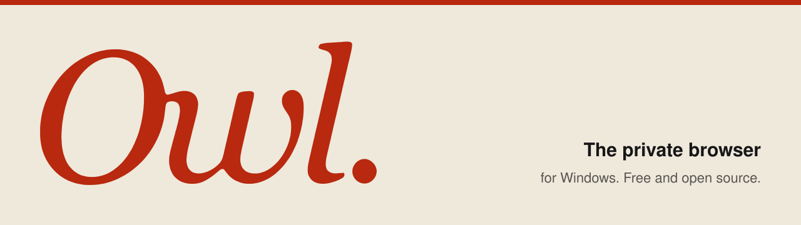
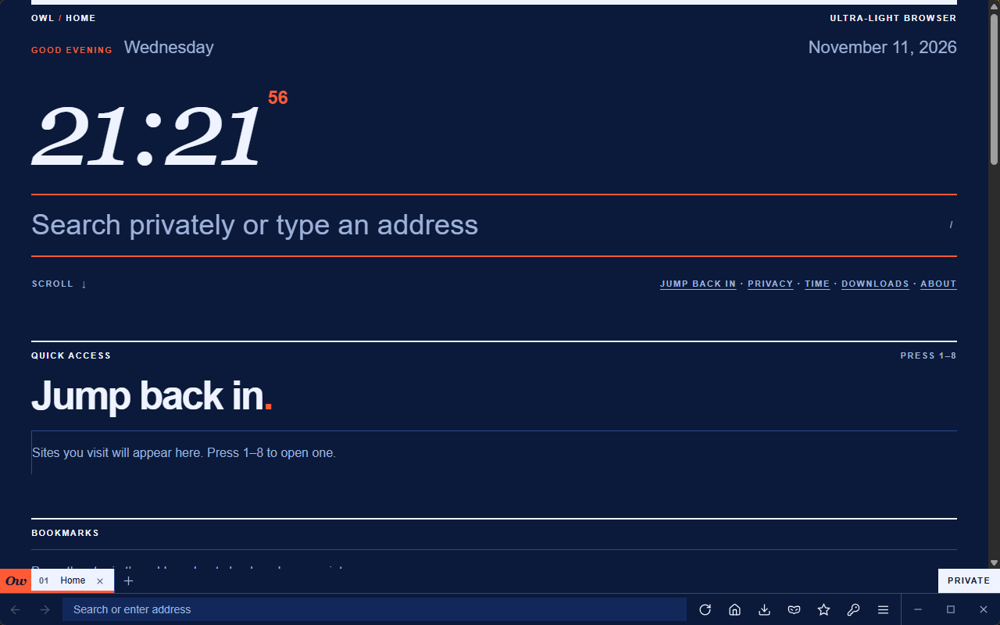
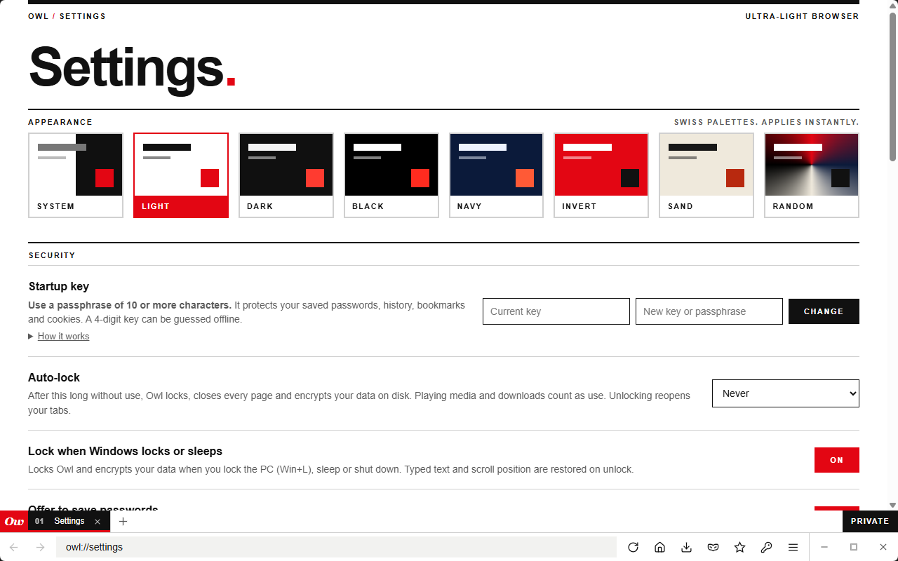
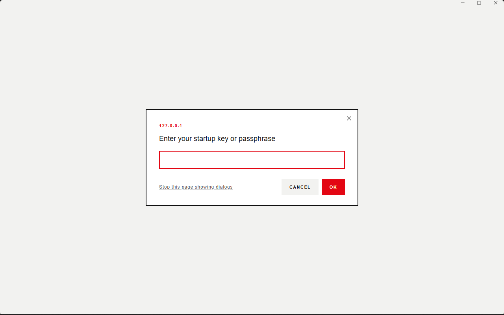
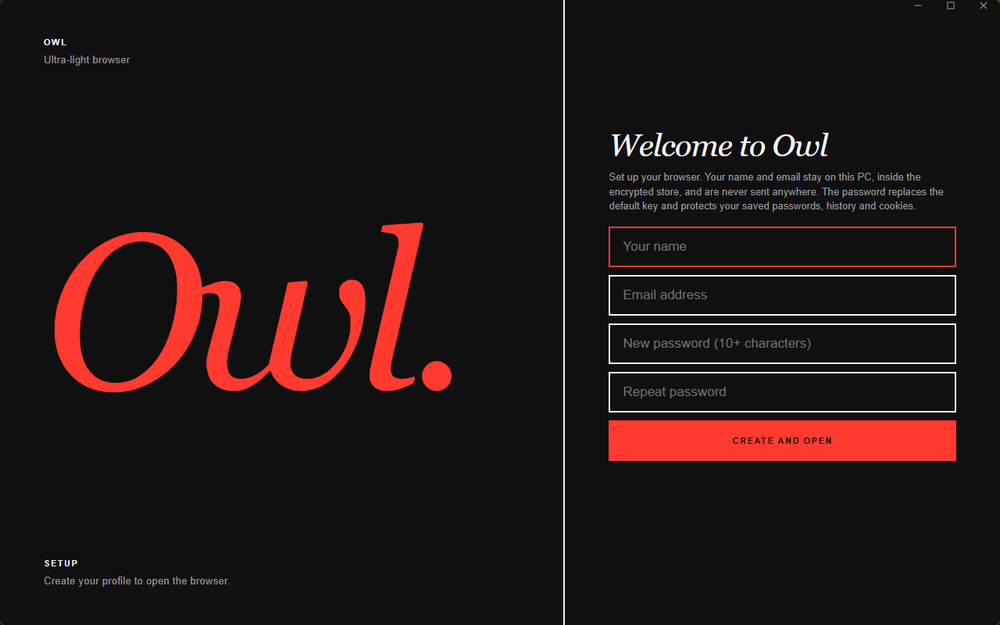

<p align="center">
  
</p>

<p align="center">
  <a href="https://github.com/fardinahosancse/owl-browser/actions/workflows/ci.yml"></a>
  <a href="https://github.com/fardinahosancse/owl-browser/releases/latest"></a>
  <a href="LICENSE"></a>
  
  
</p>

<p align="center">
  <b>Owl</b> is a small, fast and private desktop browser for Windows. It is written in Rust,
  renders with the system's Edge WebView2 engine, and wraps it in a Swiss-style interface that
  puts the address bar and tabs at the bottom and gives the page every other pixel.
</p>

---

## Contents

- [Highlights](#highlights)
- [Install](#install)
- [Prerequisites](#prerequisites)
- [Build from source](#build-from-source)
- [First run](#first-run)
- [Keyboard shortcuts](#keyboard-shortcuts)
- [Where your data lives](#where-your-data-lives)
- [Privacy and security](#privacy-and-security)
- [Architecture](#architecture)
- [Releases and CI/CD](#releases-and-cicd)
- [Contributing](#contributing)
- [Credits](#credits)
- [License](#license)

## Highlights

| | |
|---|---|
| **Tiny** | The whole browser is a single executable of about 7 MB. The page engine is the Edge WebView2 runtime already on your PC, so YouTube, Facebook, logins, caching and 1080p60 video work as in Edge. |
| **Swiss design** | A footer toolbar (tabs, address bar, window controls), generous type, a red accent, and light, dark, black, navy, invert, sand and random themes. Motion respects the system "reduce motion" setting. |
| **Fast and light** | A segmented download engine (up to 8 connections, pause, resume, queue, speed limit), a built-in BitTorrent client that runs only on demand, a Data saver slider, a video and audio download button, and Save image as in several formats. |
| **Private by default** | Built-in tracker and ad blocking, HTTPS-only mode, Global Privacy Control, fingerprint noise, a permission policy, an optional proxy or Tor, and private windows that never save anything. See [Privacy and security](#privacy-and-security). |
| **Encrypted at rest** | Cookies, saved logins, history and site storage are sealed on lock, on exit, after a crash and at Windows shutdown. Saved passwords are bound to your passphrase. |
| **Start-up passphrase** | A first-run profile replaces the default key with your own passphrase. Wrong guesses are rate-limited and locked out with growing delays. |
| **Real browser features** | Tabs with drag reorder, pin, mute and duplicate; bookmarks with groups; history; a download manager with pause, resume, speed and folders; find in page; zoom; a password manager; session restore; a now-playing widget for music and video. |

## Screenshots

| | |
|---|---|
|  |  |
| **Home**: clock, search and quick access (Navy theme). | **Settings**: grouped, with eight Swiss themes (Light shown). |
|  |  |
| **In-app dialogs** replace system alert and prompt boxes. | **First run**: create your profile and passphrase. |

All screenshots are captured from a fresh, throwaway profile.

## Install

### Installer (recommended)

1. Open the [latest release](https://github.com/fardinahosancse/owl-browser/releases/latest).
2. Download `Owl-Setup-<version>.exe` and run it.
3. Start **Owl** from the Start menu.

The installer is per-user by default (no administrator rights needed), adds Start menu and
optional desktop shortcuts, and offers to remove your data when you uninstall (it keeps it by
default).

### Portable

Download `Owl-<version>-portable.zip`, extract it anywhere and run `Owl.exe`.

Every release publishes a `SHA256SUMS.txt`. Verify your download:

```powershell
Get-FileHash .\Owl-Setup-<version>.exe -Algorithm SHA256
```

## Prerequisites

To **run** Owl:

| Requirement | Notes |
|---|---|
| Windows 10 (1809+) or Windows 11, 64-bit | |
| Microsoft Edge WebView2 Runtime | Already included with Windows 11 and current Windows 10. The installer checks for it and links to the official download if it is missing. |

To **build** Owl from source:

| Requirement | Notes |
|---|---|
| [Rust](https://rustup.rs) stable, 1.80 or newer | `rustup default stable` |
| A Windows linker toolchain | Either [Visual Studio Build Tools](https://visualstudio.microsoft.com/visual-cpp-build-tools/) (MSVC, "Desktop development with C++") **or** MSYS2/MinGW-w64 with the `x86_64-pc-windows-gnu` Rust target |
| Git | |
| [Inno Setup 6](https://jrsoftware.org/isinfo.php) | Only if you want to build the installer locally |

## Build from source

```powershell
git clone https://github.com/fardinahosancse/owl-browser.git
cd owl-browser

# optimised, size-tuned build (output: target\release\owl.exe)
cargo build --release --locked
```

With the GNU toolchain the WebView2 loader is a separate DLL. It is produced during the build
under `target\release\build\webview2-com-sys-*\out\x64\WebView2Loader.dll`; keep it next to
`owl.exe`. The MSVC toolchain links the loader statically and needs no extra file.

Build the installer (optional):

```powershell
$env:OWL_VERSION = "0.1.0"
New-Item -ItemType Directory dist -Force | Out-Null
Copy-Item target\release\owl.exe dist\Owl.exe
iscc installer\owl.iss        # writes installer\Output\Owl-Setup-0.1.0.exe
```

## First run

1. A **Welcome** screen asks for your name, email and a new passphrase (12 or more characters).
   Your name and email stay on this PC inside the encrypted store and are never sent anywhere.
2. Owl opens to the home page: clock, search, quick access, bookmark groups, time-online and
   privacy statistics, downloads and shortcuts.
3. Open **Menu > Settings** to choose a theme, set auto-lock, a proxy, sync and more.

## Keyboard shortcuts

| Shortcut | Action | Shortcut | Action |
|---|---|---|---|
| `Ctrl+T` | New tab | `Ctrl+L` | Address bar |
| `Ctrl+W` | Close tab | `Ctrl+F` | Find in page |
| `Ctrl+D` | Bookmark | `Ctrl+B` | Bookmark bar |
| `Ctrl+H` | History | `Ctrl+R` / `F5` | Reload |
| `Alt+Left` / `Alt+Right` | Back / forward | `F11` | Full screen |
| `Ctrl+` `+` `-` `0` | Zoom | `Ctrl+Shift+L` | Lock Owl |
| `F12` | Developer tools (page tabs) | | |

## Where your data lives

Everything is local, under `%LOCALAPPDATA%\Owl`:

| Path | Contents |
|---|---|
| `config.json` (+ `config.bak`) | Settings, wrapped keys, key-derivation salt. Contains no passwords. |
| `store.json` | History, bookmarks, session, downloads and statistics. **Encrypted.** |
| `vault.json` (+ `vault.bak`) | Saved passwords, each encrypted with Windows DPAPI plus a secret derived from your passphrase. |
| `profile\` | The WebView2 profile. While Owl is locked or closed, sensitive files are moved into `profile\sealed.owl`. |
| `extensions\` | Optional user scripts (`*.js`) that run on every web page. |

## Privacy and security

Owl is built around a few simple rules: no account, no telemetry, and nothing leaves your PC
unless a page you open asks for it. The one optional exception is the update check below.

### Security features

| Area | What Owl does |
|---|---|
| **Encryption at rest** | History, bookmarks, session and statistics are encrypted (ChaCha20-Poly1305). Cookies, logins and site storage are sealed to an X25519 public key on lock, exit, crash recovery and Windows shutdown, so Owl can lock at any moment without asking for your password. |
| **Passphrase, not a PIN** | Keys come from one Argon2id derivation (64 MiB). Wrong guesses are rate-limited with a persisted, escalating lock-out. A first-run profile replaces the default key. |
| **Password vault** | Saved passwords are encrypted with Windows DPAPI plus a secret derived from your passphrase, so another Windows program or user cannot read them. The engine's own password and autofill storage is turned off. |
| **Keys wiped from memory** | Derived keys are overwritten when Owl locks, the key changes or Owl exits. |
| **Auto-lock** | Locks after idle time, and when Windows locks, sleeps or shuts down. Locking closes every page and seals the profile. Typed text and scroll position are restored on unlock. |
| **Safe failure** | Settings and vault writes are atomic with backups. A damaged settings file puts Owl in a recovery state instead of starting over, and a failed restore never deletes the sealed file. |
| **Strict internal pages** | `owl://` pages use a per-load nonce Content-Security-Policy, no inline handlers, and cannot be framed. Web pages can reach only a short allow-list of commands. Fullscreen, popup and dialog events come from the engine, not from page scripts. |
| **Tracker and ad blocking** | The **OwlKick Engine** (built on Brave's adblock-rust) with a built-in tracker list, optional EasyList and EasyPrivacy, cosmetic filtering and counters on the home page. Optional **strict tracking prevention** also blocks third-party trackers and their stored cookies. |
| **HTTPS-only mode** | Upgrades `http://` to `https://` and shows a warning page, with "Go back" as the default, before any plain-http page is used. The address bar shows a lock or "Not secure". |
| **Permission policy** | Sensors, local fonts, MIDI system access and window management are always refused. An optional setting refuses camera, microphone, location and notifications without asking. |
| **Fingerprint protection** | Noise on canvas and audio reads, hidden GPU model and rounded hardware hints. A strict mode also normalises screen size, language and plugins. |
| **Secure DNS** | Optional. Site names are looked up over HTTPS at Cloudflare 1.1.1.1 through a loopback-only proxy, so your network's DNS server cannot see them. It is not a VPN. |
| **Privacy signals and proxy** | Global Privacy Control is sent. An optional SOCKS or HTTP proxy (for example Tor) also carries WebRTC traffic. |
| **Downloads** | Risky file types, downloads from background tabs and bursts are held for your approval. Files open without a shell and only from the Downloads folder. Windows reputation (SmartScreen) checks are required. |
| **Dialogs** | JavaScript alerts, confirms and prompts appear in Owl's own centered dialog (with masked input for key prompts) instead of system boxes a page could use to trap you. |
| **Private windows** | Use a temporary data folder that is deleted afterwards. Nothing is saved or counted. |
| **Update check (opt-in)** | Settings > Privacy. Once a day, or on demand, Owl asks GitHub for the newest release tag. Nothing is downloaded or installed, no identifier is sent, and it is skipped when a proxy is set. |

### Supply chain

- Every release is built by GitHub Actions from a version tag, with `cargo build --release --locked`.
- Release files carry **GitHub build attestations**. Verify a download came from this repository:

  ```powershell
  gh attestation verify .\Owl-Setup-<version>.exe --repo fardinahosancse/owl-browser
  ```

- Each release publishes `SHA256SUMS.txt` and a **build log** (commit, toolchain, sizes and hashes).
- CI runs a secret scan, a dependency advisory audit and a licence and sources check (`cargo-deny`).
  GitHub Actions are pinned to commit SHAs and kept current by Dependabot.
- The files are not yet Authenticode-signed, so Windows SmartScreen may warn on first run.

### Honest limits

- Owl is a hobby-grade project and has **not** had a professional audit. See [SECURITY.md](SECURITY.md).
- While Owl is open and unlocked, other programs running as you can read its files and memory.
- Page rendering uses the system Edge WebView2 engine, so engine security fixes arrive through
  Windows and Edge updates, not through Owl.
- Fingerprint protection reduces common signals; it does not make you anonymous.
- A weak passphrase weakens everything derived from it. Use a long one.

Found a vulnerability? Please follow [SECURITY.md](SECURITY.md) and do not open a public issue.

## Architecture

```
owl.exe  (Rust, ~1 MB)
├── tao            window and event loop (borderless, custom controls)
├── wry            WebView2 hosting: one UI webview + one webview per tab
├── WebView2       Edge's engine (system runtime)
└── src/
    ├── main.rs      app state, commands, trust model, locking, tabs
    ├── ui.html      browser chrome (footer toolbar, tabs, menu, modal, lock screen)
    ├── pages.rs     owl:// pages (home, history, bookmarks, downloads, passwords, settings)
    ├── themes.rs    shared colour themes
    ├── crypt.rs     Argon2id, sub-keys, ChaCha20-Poly1305, X25519 sealed box
    ├── vault.rs     password vault (DPAPI + passphrase-bound entropy)
    ├── profile.rs   seal and restore of cookies, logins and site data
    ├── dl.rs        download manager hooks
    ├── native.rs    non-forgeable WebView2 events, permission policy, tracking level
    ├── update.rs    opt-in, notify-only release check
    └── media.rs     now-playing widget and per-tab audio
```

The chrome is a single trusted WebView that talks to Rust over a JSON command channel. Page
webviews are untrusted and get an explicit allow-list of commands.

## Releases and CI/CD

- **CI** (`.github/workflows/ci.yml`) builds on every push and pull request, runs a secret scan and
  a dependency audit, and uploads the executable as a workflow artifact.
- **Release** (`.github/workflows/release.yml`) runs when a version tag is pushed. It builds the
  optimised executable, compiles the **installer** with Inno Setup, creates a portable zip,
  checksums, a build log and build attestations, takes the release notes from [CHANGELOG.md](CHANGELOG.md), and publishes a GitHub
  Release.

To cut a release:

```powershell
# 1. bump `version` in Cargo.toml and add a "## [x.y.z] - YYYY-MM-DD" section to CHANGELOG.md
# 2. commit, then tag and push
git commit -am "Release v0.2.0"
git tag v0.2.0
git push origin main --tags
```

The workflow refuses to publish if the tag and `Cargo.toml` version disagree.

Known problems are tracked in [Issues](https://github.com/fardinahosancse/owl-browser/issues),
each with a priority label (`P0-critical` to `P3-low`). Issues closed as completed are listed
under **Resolved issues** in the next release's notes automatically.

## Landing page

The project site lives in [`site/`](site/) as plain HTML with no framework. `node scripts/build-site.mjs` reads the newest
released version from `CHANGELOG.md` and writes it into the page: the scrolling banner at the top and the "New in" section.

It is deployed with [Vercel](https://vercel.com) using [`vercel.json`](vercel.json):

1. In Vercel, choose **Add New > Project** and import the `owl-browser` GitHub repository.
2. Leave the root directory as the repository root and the framework preset as **Other**. `vercel.json` sets the build
   command (`node scripts/build-site.mjs`) and the output folder (`site`).
3. Deploy. From then on every push to `main` deploys automatically, but only when `site/`, `CHANGELOG.md`,
   `scripts/build-site.mjs` or `vercel.json` changed (the `ignoreCommand` skips other pushes).

So releasing a version (a new `## [x.y.z]` section in `CHANGELOG.md`) updates the banner and the "New in" section
on the live site with no other step.

## Contributing

Issues and pull requests are welcome. Please read [CONTRIBUTING.md](CONTRIBUTING.md) first.

## Credits

- [Space Grotesk](https://github.com/floriankarsten/space-grotesk) typeface (SIL Open Font License 1.1, see `assets/fonts/OFL.txt`).
- [librqbit](https://github.com/ikatson/rqbit) (Apache-2.0), the BitTorrent engine.
- [adblock-rust](https://github.com/brave/adblock-rust) (MPL-2.0), the filter engine behind Owl's **OwlKick Engine**. Owl is not made or endorsed by Brave.
- [Lucide](https://lucide.dev) icons (ISC licence), drawn inline.
- [tao](https://github.com/tauri-apps/tao) and [wry](https://github.com/tauri-apps/wry) from the Tauri project.
- [webview2-com](https://github.com/wravery/webview2-rs) and the [windows](https://github.com/microsoft/windows-rs) crate.
- [Argon2](https://github.com/RustCrypto/password-hashes), [ChaCha20-Poly1305](https://github.com/RustCrypto/AEADs)
  and [x25519-dalek](https://github.com/dalek-cryptography/curve25519-dalek).
- Microsoft Edge WebView2 for the rendering engine.

## License

[MIT](LICENSE) © 2026 fardinahosancse
