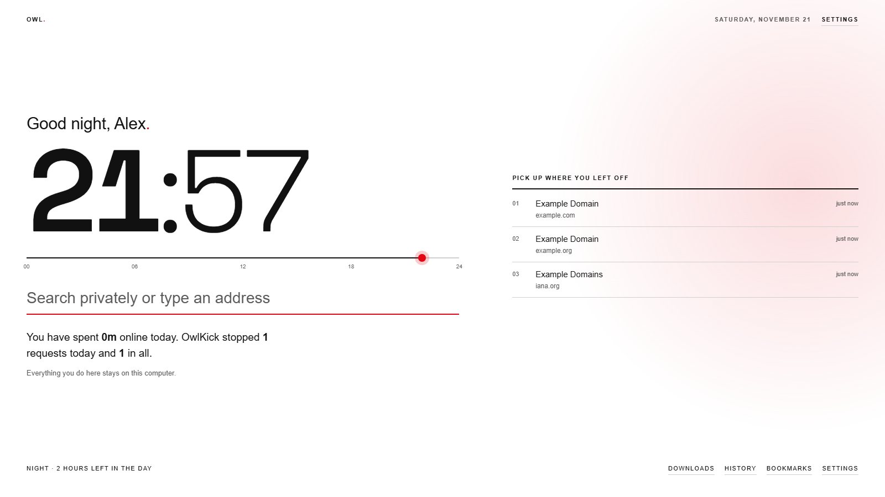
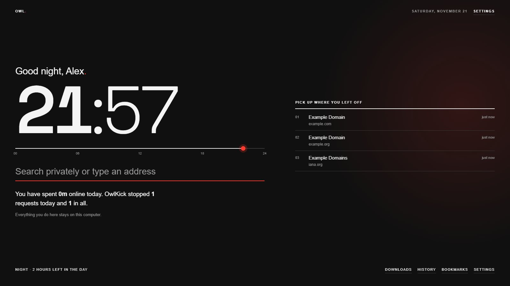
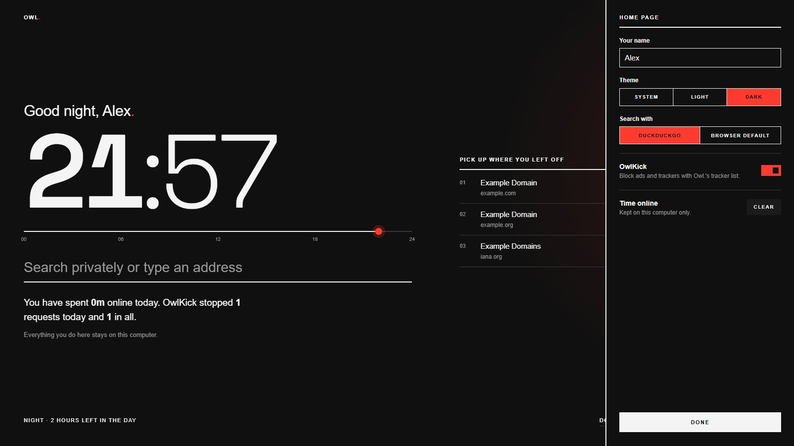

# Owl. Calm Home (browser extension)

Owl.'s calm home page as a new tab page for any Chromium browser: Chrome, Edge, Brave, Vivaldi,
Opera and Arc. It is the same page as in Owl.: a big Space Grotesk clock, a line showing how much
of the day has passed, the pages you left, where your time goes, how many trackers were blocked,
running downloads, and a private search line. Light and Dark themes, or follow the system.

| Light | Dark |
|---|---|
|  |  |

## Install

1. Download or clone this repository.
2. Open `chrome://extensions` (Edge: `edge://extensions`, Brave: `brave://extensions`).
3. Turn on **Developer mode**.
4. Choose **Load unpacked** and pick the `chrome-extension-homepage` folder.
5. Open a new tab. If the browser asks whether to keep the new tab page, choose **Keep it**.

## What it does, and where the numbers come from

| On the page | Source |
|---|---|
| Pick up where you left off | the browser's history: the six most recent sites of the last 14 days |
| You have spent ... online today; Where your time goes | the extension counts the seconds the site in the focused tab is in front of you, and stops when you are idle for a minute |
| OwlKick stopped ... requests | the extension blocks ads and trackers with Owl.'s built-in tracker list (99 hosts, 7 paths) through the browser's own blocking (declarativeNetRequest); the toolbar icon shows the count for the open tab |
| ... downloads are running | the browser's download list |
| Search privately | DuckDuckGo, or your browser's default search engine (Settings) |
| Downloads, History, Bookmarks, Settings | the browser's own pages |

**Settings** (top right): your name for the greeting, theme (System, Light, Dark), search engine,
OwlKick on or off, and clearing the time-online numbers.

## Privacy

Nothing leaves your computer. There is no server, no account and no analytics. Time online and
the blocked count are kept in the extension's local storage; history and downloads are read, never
copied anywhere. Remove the extension to remove all of it.

Permissions, and why: `history` (recent pages), `tabs` and `idle` (time per site), `downloads`
(running downloads), `declarativeNetRequest` and `declarativeNetRequestFeedback` (OwlKick and its
count), `storage` and `alarms` (keeping the numbers), `search` (optional browser-default search).

## Files

`manifest.json` (Manifest V3), `newtab.html`, `newtab.css`, `newtab.js`, `theme.js` (applies the
theme before the page paints), `background.js` (time online and blocked count),
`owlkick-rules.json` (generated from `BLOCKED_HOSTS` and `BLOCKED_PATHS` in `src/main.rs`),
`space-grotesk.woff2` (SIL Open Font License, `OFL.txt`), `icons/`.

MIT licence, like Owl.
