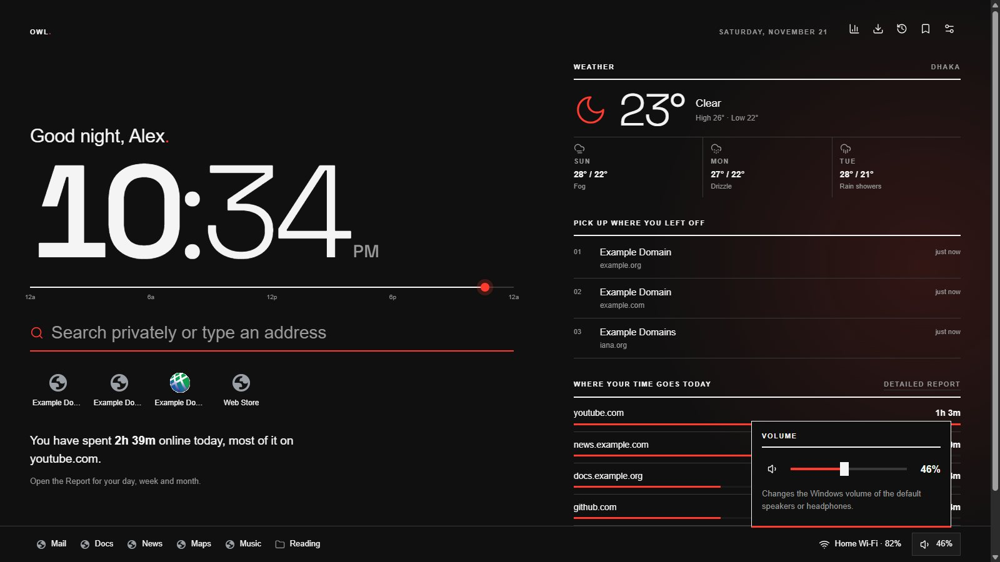
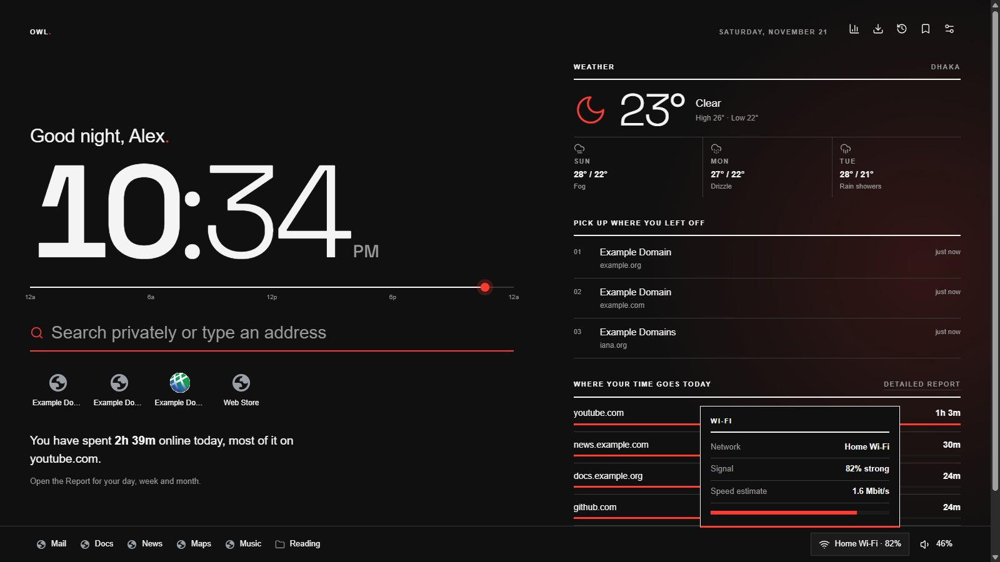
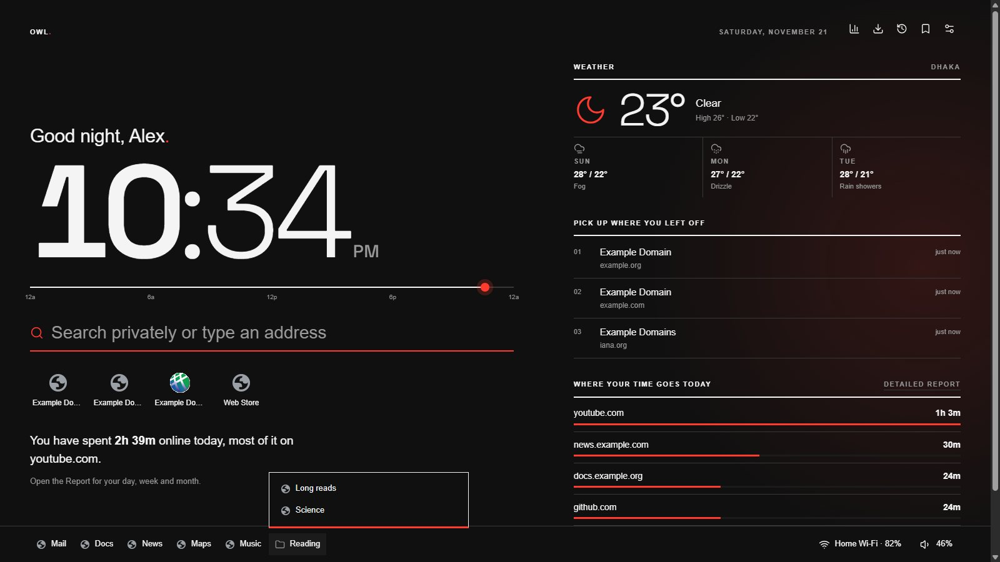
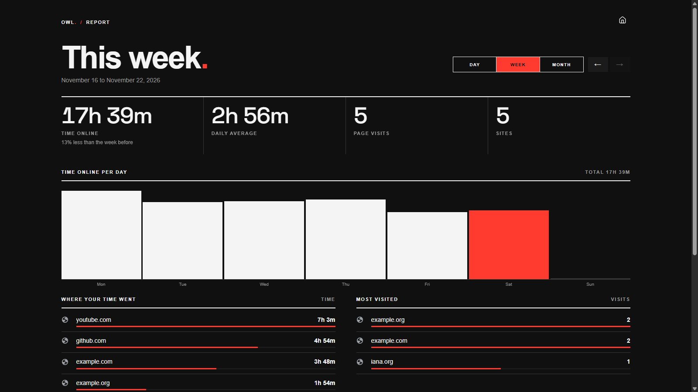

# Owl. Calm Home (browser extension)

Owl.'s calm home page as a new tab page for any Chromium browser: Chrome, Edge, Brave, Vivaldi,
Opera and Arc. It is the same page as in Owl.: a big Space Grotesk clock (24-hour or 12-hour), a
line showing how much of the day has passed, a private search line with shortcuts to your most
visited sites, the weather, the pages you left and where your time goes today. Quick buttons sit
together at the top right; your favourites and the Wi-Fi and volume controls sit in a dock at the
very bottom. A **Report** shows your day, week and month. Light and Dark themes, or follow the system.

| Light, 24-hour | Dark, 12-hour, volume open |
|---|---|
|  |  |

| Wi-Fi details | A favourites folder |
|---|---|
|  |  |

| Report: this week | Settings |
|---|---|
|  |  |

Screenshots use sample data on example sites; the Wi-Fi name is made up.

## Install

1. Download or clone this repository.
2. Open `chrome://extensions` (Edge: `edge://extensions`, Brave: `brave://extensions`).
3. Turn on **Developer mode**.
4. Choose **Load unpacked** and pick the `chrome-extension-homepage` folder. Its ID is always
   `lejabghpgomlgigjhibhnocaddmlofid`.
5. Open a new tab. If the browser asks whether to keep the new tab page, choose **Keep it**.

**Updating:** after the folder changes (a new download or `git pull`), open the extensions page
and press **Reload** on Owl. Calm Home. The browser picks up new page files at once but keeps the
old permissions until you reload; the home page says so when that is needed.

## Wi-Fi and volume (optional Windows helper)

Browsers keep extensions away from Windows, so they cannot read the Wi-Fi name or set the system
volume by themselves. A small helper in `windows-helper/` does that, and only for this extension
(the browser starts it through *native messaging*; its manifest allows only this extension's ID).

1. In the extension folder, open `windows-helper`.
2. Right-click `install.ps1` and choose **Run with PowerShell** (or run
   `powershell -ExecutionPolicy Bypass -File install.ps1`). It registers the helper for Chrome, Edge,
   Brave, Chromium and Vivaldi, for your Windows user only, without administrator rights.
3. Open a new tab: the dock shows the network name and signal, and the volume.

The helper answers three requests (status, set volume, mute), reads the Wi-Fi details from
`netsh wlan` and the volume from Windows' audio API, opens no network connection and writes no files.
On Windows 11 24H2 and later, the Wi-Fi signal needs **Settings > Privacy > Location > Let desktop
apps access your location**; without it the network name still shows. `uninstall.ps1` removes it.
Without the helper, the dock offers a **Connect Wi-Fi and volume** button with these steps.

## What it does, and where the numbers come from

| On the page | Source |
|---|---|
| Quick buttons (top right): Report, Downloads, History, Bookmarks, home page Settings | the extension and the browser's own pages |
| Shortcuts under the search line | the browser's most visited sites |
| Favourites (bottom left), with folders | the browser's own bookmarks bar, read live: when Chrome, Brave or Edge sync changes it, the page follows |
| Wi-Fi and volume (bottom right) | the optional Windows helper above |
| Weather, today and 3 days, with icons | [Open-Meteo](https://open-meteo.com) (free, no account): your location if you allow it, or a city you search for |
| Pick up where you left off | the browser's history: the six most recent sites of the last 14 days |
| You have spent ... online today; Where your time goes today | the extension counts the seconds the site in the focused tab is in front of you, and stops when you are idle for a minute |
| ... downloads are running | the browser's download list |
| Search privately | DuckDuckGo, or your browser's default search engine |

### Report

Open **Report** from the top of the home page. Pick **Day**, **Week** or **Month**, and step back
with the arrows (or the arrow keys):

- time online, daily average (or the busiest hour for a day), page visits and sites, each compared
  with the period before;
- a chart of time online per day, or per hour for a day;
- where your time went and the most visited sites;
- a **Spotlight** on one site, YouTube first: time, share of your time online, visits and videos
  opened; switch it to any of your top sites;
- facts: busiest day and hour, days without the browser, sites new this period.

Time online starts counting the day the extension is installed and is kept for 400 days. Visits come
from the browser's history, so they go back as far as it does.

### Settings

Your name for the greeting, theme (System, Light, Dark), clock (24-hour or 12-hour), search engine,
shortcuts, favourites and Wi-Fi and volume on or off, weather (off, your location, or a city; °C or
°F), and clearing the time-online numbers.

## Privacy

Nothing about your browsing leaves your computer. There is no server, no account and no analytics.
Time online is kept in the extension's local storage; history, bookmarks and downloads are read,
never copied anywhere. The weather is the one network request: it sends Open-Meteo the place (a
city, or your location rounded to about 1 km) and nothing else, at most every 30 minutes. Turn it
off in Settings. Remove the extension to remove everything it kept.

Permissions, and why: `history` (recent pages, reports), `tabs` and `idle` (time per site),
`bookmarks` and `favicon` (favourites), `topSites` (shortcuts), `nativeMessaging` (the optional
Windows helper), `geolocation` (weather for your location, only when
you choose it), `downloads` (running downloads), `storage` and `alarms` (keeping the numbers),
`search` (optional browser-default search), and access to `api.open-meteo.com` and
`geocoding-api.open-meteo.com` (weather and city search).

## Files

`manifest.json` (Manifest V3), `newtab.html`, `newtab.css`, `newtab.js`, `report.html`,
`report.css`, `report.js`, `common.js` (shared helpers), `icons.js` (Lucide icons, ISC licence),
`windows-helper/` (the optional Wi-Fi and volume helper), `theme.js` (applies the theme before the
page paints), `background.js` (time online per day, site and hour), `space-grotesk.woff2` (SIL Open
Font License, `OFL.txt`), `icons/`.

## Changes

- **1.2.0**: real icons throughout (quick buttons, weather, Wi-Fi, volume, folders); quick buttons
  together at the top; favourites and quick controls in a dock at the bottom; shortcuts to the most
  visited sites; Wi-Fi name and signal and Windows volume through an optional helper; the link to
  the browser's settings is gone; a fixed extension ID.
- **1.1.1**: the weather spot (top of the right-hand column) explains why there is no weather
  instead of staying empty; the page notices when the extension still needs a reload after an
  update; choosing a city closes the settings so you see the weather.
- **1.1.0**: Report (day, week, month, YouTube spotlight, facts); weather by location or city;
  bookmarks bar read live from the browser; 12-hour clock option; OwlKick blocking removed (use
  your browser's or another blocker's).
- **1.0.0**: first version.

MIT licence, like Owl.
