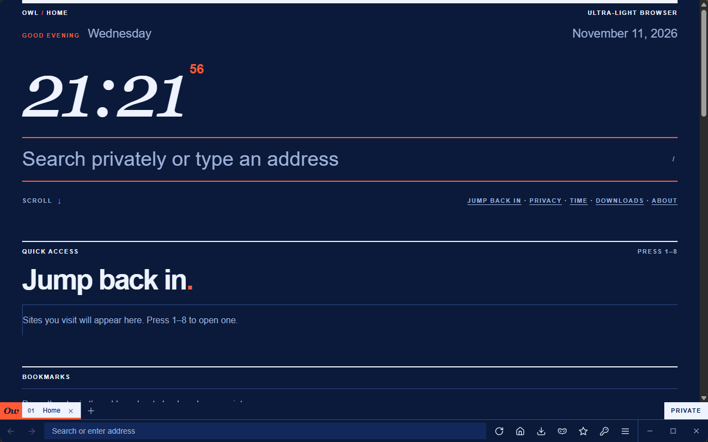

# Owl

**Owl** is a small, fast and private desktop browser for Windows. It is written in Rust, renders with the system's Edge WebView2 engine, and wraps it in a Swiss-style interface with the address bar and tabs at the bottom.

## Start here

| I want to... | Read |
|---|---|
| Install Owl | [Installation](Installation) |
| Take my first steps | [Getting Started](Getting-Started) |
| See what it can do | [Features](Features) |
| Understand the protection | [Security Model](Security-Model) |
| Tune privacy settings | [Privacy Settings](Privacy-Settings) |
| Learn the shortcuts | [Keyboard Shortcuts](Keyboard-Shortcuts) |
| Find my files | [Data and Files](Data-and-Files) |
| Fix a problem | [Troubleshooting](Troubleshooting) |
| Build or contribute | [Building from Source](Building-from-Source), [Architecture](Architecture) |
| Check a download | [Releases and Verification](Releases-and-Verification) |

## At a glance

- About 1 MB executable. The engine is the Edge WebView2 runtime already on your PC.
- No account, no telemetry, no analytics.
- Encrypted at rest with a startup passphrase.
- MIT licensed. Source: https://github.com/fardinahosancse/owl-browser
